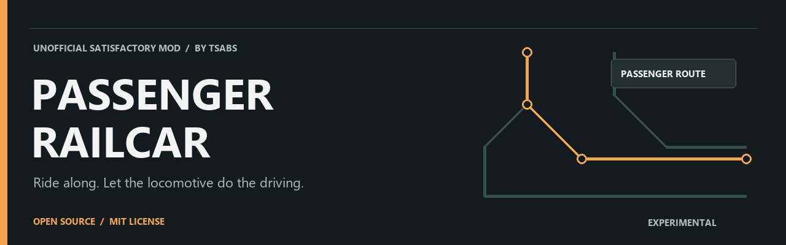

# Satisfactory Passenger Railcar

**Viaja en el tren. Deja que la locomotora se encargue de conducir.**  
Mod no oficial de vagón de pasajeros para **Satisfactory en Steam**, creado por **Tsabs**, con código abierto bajo **MIT**.

**[Descargar 0.1.8](https://github.com/Tsavyh/satisfactory-passenger-railcar/releases/download/v0.1.8/TsabsPassengerWagon-0.1.8-Steam-Proton-Publico.zip)** · [English](README.md) · [Compilar el código](BUILDING.es.md) · [Comunicar un problema](https://github.com/Tsavyh/satisfactory-passenger-railcar/issues/new/choose)

> **Versión preliminar.** El arranque en Windows DX11 está verificado. **Proton y multijugador siguen pendientes de validación.** Haz copia de los guardados y usa una partida de pruebas, no una partida personal.

## Qué ofrece

- Un vagón enganchable al tren con **una plaza técnica invisible por vagón** en esta fase.
- **Cámara exterior orbital**, sin controles para conducir la locomotora.
- **Sin inventario de carga, interior transitable ni sillas visibles.**
- Subida y bajada con velocidad absoluta **estrictamente inferior a 30 km/h**, también marcha atrás, siempre que se cumplan los controles de ocupación, autoridad y salida segura. A 30 km/h o más se bloquea el acceso; no se limita la velocidad de circulación del tren.

Durante las pruebas no tiene coste de construcción ni requisito de desbloqueo. El equilibrio final y la ampliación de plazas están pendientes.

## Instalación

**Entorno objetivo:** Satisfactory Steam **1.2.4.1 / CL 513885** y **SML 3.12.0**. Otras versiones y tiendas no están verificadas.

1. Instala SML mediante Satisfactory Mod Manager. Si ya arranca SML solo, conserva esa configuración.
2. Cierra el juego y descarga **[el ZIP instalable](https://github.com/Tsavyh/satisfactory-passenger-railcar/releases/download/v0.1.8/TsabsPassengerWagon-0.1.8-Steam-Proton-Publico.zip)**. Los archivos **Source code** de GitHub no sirven para instalar directamente.
3. Conserva la carpeta anterior del vagón **fuera** de `FactoryGame/Mods` y copia `VAGON/TsabsPassengerWagon` del ZIP a `FactoryGame/Mods`. No mezcles versiones ni reemplaces la carpeta de SML.
4. **Primera prueba: llegar únicamente al menú** y comprobar que aparece la 0.1.8. No abras todavía una partida personal. En Proton, mantén la versión y las opciones de arranque actuales durante esta comprobación.

La ruta final debe ser:

```text
FactoryGame/Mods/TsabsPassengerWagon/TsabsPassengerWagon.uplugin
```

El ZIP incluye instrucciones, licencia MIT, un perfil opcional de SML solo y un manifiesto; no incluye SML, SDK ni datos personales. El checksum está en `SHA256SUMS-Publico.txt` de la release.

## Qué está probado y qué falta

| Entorno o función | Estado |
| :--- | :--- |
| Arranque Windows / Steam | Menú verificado en una prueba real de 0.1.8 con DX11 |
| Linux / Steam / Proton | La 0.1.7 tenía un bloqueo reportado; falta probar la corrección 0.1.8 en ese equipo |
| Multijugador con cliente remoto | Pendiente |
| Viaje con otro jugador conduciendo y con piloto automático | Son pruebas separadas todavía pendientes |
| Servidor dedicado y otras tiendas | Sin versión validada |

La corrección 0.1.8 eliminó una cascada de **454 errores de carga** en el caso reproducido en Windows. **Eso no demuestra todavía que el bloqueo completo de Proton esté resuelto.** [Cambios de versión](CHANGELOG.md).

Si vuelve a fallar, conserva el log de ese intento antes de arrancar otra vez y retira solo el vagón para recuperar SML solo. No publiques identificadores de cuentas, parámetros de autenticación ni rutas personales. Puedes usar el [formulario de problemas](https://github.com/Tsavyh/satisfactory-passenger-railcar/issues/new?template=bug_report.yml).

## Código abierto

Fuentes propias bajo **[MIT](LICENSE)**, con [instrucciones de compilación](BUILDING.es.md), pruebas y [límites de recursos de terceros](NOTICES.md). El [tag v0.1.8](https://github.com/Tsavyh/satisfactory-passenger-railcar/tree/v0.1.8) conserva las fuentes del binario publicado. Este cambio de presentación no modifica el código de ejecución, los tags ni las descargas.

El identificador interno **`TsabsPassengerWagon`** se mantiene por compatibilidad. El nombre público es **Satisfactory Passenger Railcar**. El SDK, Engine y recursos del juego se obtienen por separado.

---

Proyecto comunitario no oficial. La portada es una ilustración original de marca, **no una captura del juego**.
